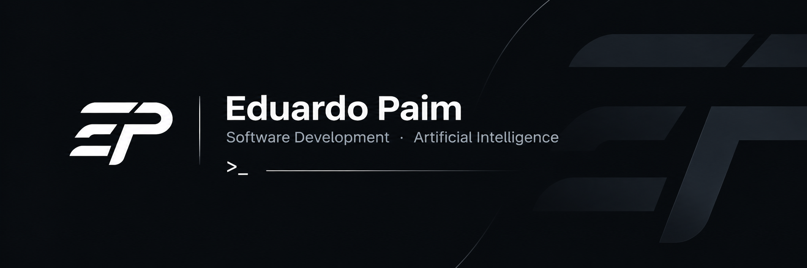
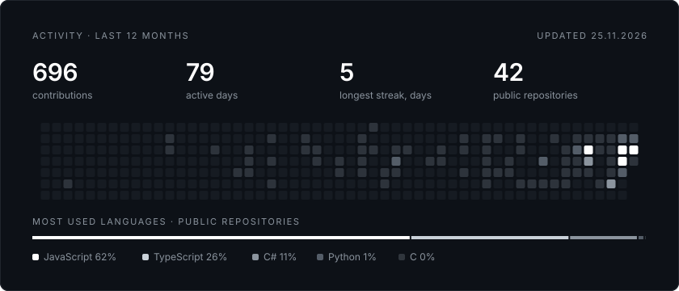

  

  SOFTWARE DEVELOPMENT &nbsp;&nbsp;·&nbsp;&nbsp; ARTIFICIAL INTELLIGENCE &nbsp;&nbsp;·&nbsp;&nbsp; AI ORCHESTRATION

  <i>Building intelligent software and orchestrating AI-powered development workflows.</i>

 

### About Me

I'm Eduardo Paim, a software developer from Caxias do Sul, Brazil, with a technical background in cyber-systems for industrial automation. Currently at Teknike — Solutions for Food Process.

My work sits between the factory floor and modern software: APIs in C# and .NET, web applications in React and TypeScript, and AI applied where it is actually useful — from local language models that help diagnose machines to desktop tools that coordinate multiple coding agents on the same project.

I care about software that is practical, readable and made to be used.

 

### Tech Stack

| Area | Stack |
| :-- | :-- |
| **Software Development** | C# · .NET / ASP.NET Core · Entity Framework Core · TypeScript · JavaScript · Python · SQL Server · Node.js / Express |
| **Artificial Intelligence & AI Tooling** | Claude Code · Claude Agent SDK · Codex · Ollama (Qwen3) · FastAPI · multi-agent workflows |
| **Frameworks & Tools** | React · Vite · Tailwind CSS · Electron · Phaser · Firebase · MQTT · Vercel · Git |

 

### Featured Projects

**[OfficeAI](https://github.com/PaimEdu-DEV/OfficeAI)** 
TYPESCRIPT · ELECTRON · REACT · PHASER · CLAUDE AGENT SDK 
Desktop environment that runs AI coding agents — Claude, through the Claude Agent SDK, and Codex — side by side, with a shared message bridge, project and process management, and a pixel-art office interface to follow their work.

**[Supervisório Nexa AI](https://github.com/PaimEdu-DEV/SupervisorioNexaAI)** 
C# · ASP.NET CORE · MQTT · PYTHON · FASTAPI · OLLAMA 
Industrial supervisory system: machine telemetry over MQTT, tag history and maintenance records, with an AI diagnostic service running a local Qwen3 model behind a pluggable provider layer.

**[prompt-evaluator](https://github.com/PaimEdu-DEV/prompt-evaluator)** 
CLAUDE CODE SKILL 
Scores vague implementation requests from 0 to 10 and asks only for what is missing — where, what, the rule, a reference, the definition of done — before any code is written.

**[DevCore](https://github.com/PaimEdu-DEV/DevCore)** &nbsp;[live ↗](https://dev-core-delta.vercel.app) 
TYPESCRIPT · FIREBASE · VERCEL 
Pixel-art medieval RPG where players learn Python and JavaScript by defeating villains with real code.

More work in [repositories →](https://github.com/PaimEdu-DEV?tab=repositories)

 

### GitHub Activity

  

Generated daily from public GitHub data by a workflow in this repository.

 

EDUARDO PAIM &nbsp;·&nbsp; CAXIAS DO SUL, BRAZIL

